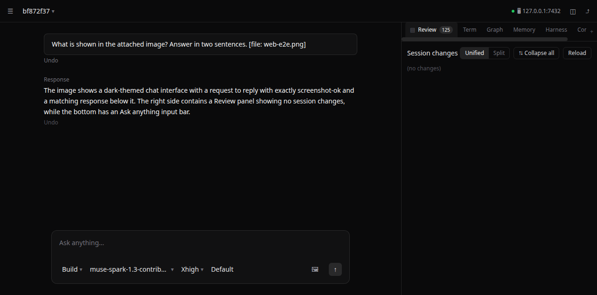

# Lumina — local-first AI coding & open-world agent harness

See `plan.md` for the full architecture & implementation plan,
and `test-plan.md` for the verification matrix (all suites PASS).

## Quickstart

```bash
make build                       # web SPA + static Go binary -> bin/lumina
./bin/lumina --help
./bin/lumina serve                # daemon on 127.0.0.1:7432
./bin/lumina run "explain this repo" --agent plan
```

BYO-LLM is configured in `~/.config/lumina/config.toml` (OpenAI-compatible,
Anthropic-compatible, Ollama, OpenAI-Responses, and **Copilot** protocols;
keys only via `api_key_env` / `api_key_cmd` — plaintext keys are rejected at load).

## Config reference (`~/.config/lumina/config.toml`)

```toml
[server]
host = "127.0.0.1"
port = 7432

[defaults]
agent = "build"            # new TUI sessions + `lumina run`
permission_mode = "bypass"    # ask | auto-edit | auto-approve | bypass

[compat]
import_global_rules = true   # ~/.config/lumina/AGENTS.md + instructions/
import_global_skills = true  # ~/.config/lumina/skills/

[permissions]
edit = "allow"
external_directory = "ask"

[permissions.bash]           # glob-matched, first match wins
"git status*" = "allow"
"git diff*"   = "allow"
"go test*"    = "allow"
"*"           = "ask"

[providers.local]
protocol = "ollama"
base_url = "http://127.0.0.1:11434"

[providers.openrouter]
protocol = "openai-compatible"
base_url = "https://openrouter.ai/api/v1"
api_key_env = "OPENROUTER_API_KEY"   # or api_key_cmd = "pass show ..."

[router]                       # fast = background, executor = main coding
fast     = "local/qwen2.5-coder:7b"
executor = "openrouter/deepseek/deepseek-r1"
planner  = ""                  # empty = fall back to executor
improver = "openrouter/deepseek/deepseek-r1"

[kb]
idle_debounce_minutes = 15
standing_ops = false           # auto-distill transcripts into ./memory/

[websearch]                    # needs a provider key to do anything
provider = ""                  # exa | firecrawl | parallel | tavily | tinyfish
```

Env overrides: `LUMINA_CONFIG` (config path), `LUMINA_DB` (SQLite path),
`LUMINA_TOKEN` (daemon auth + client), `LUMINA_URL` (which daemon the TUI talks to).

## CLI

| Command | What it does |
|---|---|
| `lumina [--agent plan\|build] [-c] [-s <id>] [--auto-edit\|-y\|--bypass]` | Open the Terminal TUI (starts a daemon in-process if `:7432` is free). `-c` resumes the latest session for the directory, `-s` resumes one by id. `[defaults]` apply unless a flag overrides them. |
| `lumina run [flags] "<prompt>"` | Headless one-shot. Flags work in any position, `--flag=value` too: `--agent`, `--plan`, `-c`, `-s <id>`, `-m model`, `--format text\|json`, `--auto-edit`, `-y`, `--bypass`, `--effort low\|medium\|high\|xhigh\|max`, `--attach <image>` (repeatable, 8MB cap each), `--` to end flags. |
| `lumina serve [--host 127.0.0.1] [--port 7432]` | Headless daemon (REST + SSE + PTY). Non-loopback binds require `LUMINA_TOKEN`. |
| `lumina web` | Ensure the daemon is up, then point your browser at it (embedded SPA). |
| `lumina attach <url>` | Run the TUI against a remote/LAN daemon (needs `LUMINA_TOKEN` set). |
| `lumina session list [dir\|--all]` | Sessions for this directory (or all). |
| `lumina session show <id>` | Turn-by-turn transcript. |
| `lumina session fork <id> [turn]` | Branch a session (optionally at a turn). |
| `lumina session export <id> [--sanitize]` | Markdown transcript; `--sanitize` redacts secrets. |
| `lumina plugin list \| doctor` | Show discovered JS/TS plugins; check the Node v22 host. |
| `lumina kb query "<q>" \| reflect \| status` | Query the Markdown+graphify graph, print `LESSONS.md`+`MEMORY.md`, show graph freshness. |
| `lumina kb update <topic> "<note>"` | Append a durable fact to `./memory/<topic>.md` (deduped). |
| `lumina evolve [session-id]` | Harness² self-improvement pass (`Propose → Probe → Compose`, quality-floor gated). |
| `lumina models --provider <name>` | List live models for a provider. |
| `lumina auth device --provider <name> [--github-url URL]` | GitHub device flow; token stored `0600`, never printed. |
| `lumina pair [--lan]` | Print the attach URL + token for another machine. |
| `lumina openapi --out <file>` | Dump the daemon OpenAPI 3.1 spec (source of the web TS SDK). |

## Terminal TUI (`lumina`)

The TUI talks to the daemon exclusively through `pkg/sdk`. Keys:

- `Tab` / `Shift+Tab` — flip primary agent (`plan`/`build`) / cycle
  approval mode (`ask` → `auto-edit` → `auto-approve` → `bypass`)
- `Enter` — steer the running turn; `Ctrl+X` then `Enter` — queue behind it
- `Esc` — cancel armed queue / close popup; `Ctrl+U` — clear line; `Ctrl+C/D` — quit
- `/` — autocomplete popup (slash commands, `@file` paths, `[[memory-note]]`
  names); `↑↓` navigate, `Tab` accepts, `Esc` dismisses
- Approval modal — `←/→` (or `h`/`l`) choose **Allow Once / Allow Session / Deny**, `Enter` answers

Slash commands: `/plan`, `/build`, `/model [filter]`, `/variant [auto|low|medium|high|xhigh|max]`,
`/mode [ask|auto-edit|auto-approve|bypass]`,
`/connect [provider] [github-url]`, `/compact`, `/thinking [show|hide]`, `/undo`, `/redo`,
`/resume`, `/continue`, `/fork`, `/graphify`, `/evolve`, `/init`.

The header shows the current reasoning variant (`variant:xhigh`, `variant:auto`
by default; `/variant` picks it per turn) plus a live context gauge (`ctx ~12.6k/128k`, provider-advertised
window; `ctx ~12.6k` used-only when the provider reports none) and turn
footers repeat it (`model · 2.1s · 50 tok/s · ctx ~12.6k/128k`).

```toml
# GitHub Copilot: per-user endpoint (SaaS default; override for Enterprise/GHES)
[providers.copilot]
protocol = "copilot"
base_url = "https://api.githubcopilot.com"   # optional override
# token_url = "https://HOST/api/v3/copilot_internal/v2/token"  # GHES only
api_key_cmd = "gh auth token"                # or api_key_env = "GH_TOKEN"

[router]
executor = "copilot/gpt-4o"
```

Connect interactively: TUI `/model` (pick a live model, persists), TUI
`/connect` (pick provider → enter GitHub URL → open link → auto-poll to
connected), web sidebar **Copilot web auth** (device code), or terminal
`lumina auth device --provider copilot [--github-url URL]` (prints URL +
code, stores the token `0600` daemon-side, never shown). List live models
any time with `lumina models --provider copilot`.

## Approval modes & agent fence

`Tab` switches **what the agent may structurally do**; `Shift+Tab` switches
**how approvals prompt**:

| Action | ask | auto-edit | auto-approve | bypass |
|---|---|---|---|---|
| Reads (`read`, `glob`, `grep`, `kb_query`) | allow | allow | allow | allow |
| File edits | ask | allow | allow | allow |
| Safe shell (`git status/diff`, `go test`) | allow | allow | allow | allow |
| General shell | ask | ask | allow | allow (no prompts) |
| Destructive shell (`rm -rf`, `git push --force`) | ask | ask | ask | allow |
| Credential files / Google domains | **deny** | **deny** | **deny** | **deny** |

`plan` agent is read-only except `plan.md` / `.lumina/plans/*.md` — even
under `bypass`. Approving a plan hands the session to `build` in place.

## Sessions, undo, compaction

- `-c` / `-s` resume; `session fork` branches; the web session menu and
  TUI `/resume` (picker) / `/continue` (latest) attach previous sessions in
  the same workspace. All clients on one session stay in sync over SSE.
- `/undo` / `/redo` restore per-turn shadow-Git checkpoints without touching
  your index or `git log`.
- `/compact` (or auto-compact near the context limit) summarizes stale
  tool output while keeping rules, diffs, and `./memory` pointers.
- `session export --sanitize` redacts `sk-*`, `AKIA*`, `Bearer`, `api_key=` shapes.

## Global rules & skills

Drop-in Markdown customization, reloaded on every turn (no restart):

- `~/.config/lumina/AGENTS.md` — global system instructions (Layer 1:
  under the immutable security core, above repo rules).
- `~/.config/lumina/instructions/*.md` — one extra layer per file.
- `~/.config/lumina/skills/<name>/SKILL.md` — auto-discovered; only
  `name` + `description` frontmatter is advertised until the model calls
  the `skill` tool to load the body:
  ```markdown
  ---
  name: my-skill
  description: When to use this, in one line.
  ---
  ```
- `~/.config/lumina/agents/*.md`, `~/.config/lumina/commands/*.md` —
  custom subagents (`mode: subagent|primary`) and slash commands.

Workspace equivalents: repo-root `AGENTS.md` (or `CLAUDE.md` fallback),
`.lumina/skills/`, `.lumina/agents/`, `.lumina/commands/`. Disable the
global imports with `[compat] import_global_rules = false` /
`import_global_skills = false`.

## Providers, models, context

`protocol = "copilot"` needs an exchangeable GitHub token (`gh auth token`,
device flow, or token store); everything OpenAI-shaped uses
`openai-compatible` (OpenRouter, DeepSeek, vLLM, LM Studio…), plus
`anthropic-compatible`, `ollama`, and `openai-responses`. Router tiers:
`fast` (background), `executor` (main coding), `planner` (plan mode,
falls back to executor), `improver` (Harness²). Switch live via TUI
`/model`, web picker, or `PUT /api/v1/router`.

The context gauge reads each provider's advertised window (`/models`
`context_length`, Ollama `/api/show`), cached per provider — no hardcoded
max. Reasoning effort (`--effort` / composer `auto…max`) is forwarded to
providers that support it.

## MCP (`mcp` tool)

`.lumina/mcp.json` (workspace wins over `~/.config/lumina/mcp.json`):

```json
{"servers": {
  "local":  {"transport": "stdio", "command": "my-mcp", "args": ["serve"]},
  "remote": {"transport": "sse", "url": "http://127.0.0.1:9000/mcp"}
}}
```

The model calls tools via `initialize → tools/list → tools/call` (stdio is
newline-delimited JSON-RPC). Google URLs are rejected at dial time.

## Memory & knowledge (`kb` tool)

Durable notes live in `./memory/*.md` (YAML frontmatter +
`[[wikilinks]]`); `graphify` builds queryable graphs into
`memory/graphify-out/` (`graph.json`, `GRAPH_REPORT.md`, `graph.html`).
The agent searches memory with `kb_query` before grepping code, saves with
`memory_write`, and `standing_ops = true` auto-distills idle sessions.
Plugins live in `~/.config/lumina/plugins/` or `.lumina/plugins/`
(`chat.message`, `tool.execute.before/after`, `shell.env`,
`permission.ask`, `event` hooks on a Node v22 worker).

## Web mode (`lumina web`)

`lumina serve` hosts the daemon **and** the embedded React workspace — a
dark UI: top bar (session menu, live context pill, server badge, panel
toggles), centered new-session view (workspace, branch, last-modified +
composer), and active sessions with a right **Review** pane (Unified/Split diffs, Collapse all,
per-file sections) plus Terminal, Graph, Memory, Harness, and Copilot-connect
tabs. Composer footer holds the agent (`plan`/`build`), live model picker
(router tiers + Copilot `/models` + custom id), reasoning-effort variants
(`auto`/`low`/`medium`/`high`/`xhigh`/`max`), an image **attach button**
(8MB cap each; vision-capable models describe attached images), and approval mode
(`Default` = ask). `Tab` / `Shift+Tab` flip agent and approval without
leaving the keyboard; the Servers modal switches which daemon the app talks
to (persisted per browser). Approval requests pop a modal (Allow once /
Allow session / Deny); the stream auto-reconnects with backoff.

Live end-to-end test (headless browser vs daemon on `lumina/muse-spark-1.3-contributor`):
image attached in the composer + "what is shown" prompt answered correctly
by the model, effort variant `xhigh` selected and honored, reply streamed
over SSE and rendered — plus zero console errors and zero non-loopback
network requests:



Also verified live: multi-client SSE sync (two subscribers + daemon),
shadow-Git `/undo` + `/redo` through the API, plan-mode scoped writes
(`plan.md` allowed, source tree fenced), and session restart persistence.

## Daemon API (for scripts)

`GET /openapi.json` is the schema. Main routes under `/api/v1`: `sessions`
(create/list/`?latest=1`), `sessions/{id}` (get/patch agent, permission,
model, title), `prompt` (submit; `delivery: steer|queue` while running),
`fork`, `export[?sanitize=1]`, `revert`/`unrevert`, `permissions/{reqId}`,
`files`, `git/diff`, `git/branch`, `pty` (WebSocket), `providers`, `router`,
`models?provider=`, `auth/device/{start,poll}`, `kb/query`, `harness`,
`harness/evolve`, plus the `events` SSE stream (`turn.started/progress/
context/delta/tool/completed/failed`, `permission.asked/resolved`, …).

## Troubleshooting

- **Bypass/plan default ignored** — set it under `[defaults]`, not
  `[permissions]`; new sessions pick it up, old ones keep theirs
  (flip live with `Shift+Tab`).
- **Global rule/skill not applying** — exact paths (`AGENTS.md`,
  `skills/<name>/SKILL.md`), valid frontmatter, `[compat]` imports on;
  applies to the next turn, no restart.
- **Stuck at `working…`** — a `bash`/tool waiting on an unanswered
  approval modal (web) or a dropped SSE stream (both clients reconnect
  automatically; terminal `turn.completed`/`failed` is never shed).
- **Non-loopback bind refused** — set `LUMINA_TOKEN` first, then
  `lumina attach http://<host>:7432` from the other machine.
- **`session delete`** — not implemented via CLI; remove the row from
  `lumina.db` (see `LUMINA_DB`) or use the daemon API.

## Layout

- `cmd/lumina` — CLI: TUI, `run`, `serve`, `web`, `attach`, `session`, `plugin`, `kb`, `evolve`
- `internal/*` — daemon packages (config, server, security, rules, plugins, llm, agent, tools, mcp, kb, harness, tui)
- `pkg/sdk` — typed Go client for the daemon HTTP + SSE API
- `web/` — React + Vite + Tailwind workspace SPA (embedded via `//go:embed`)
- `memory/` — durable Markdown memory + `memory/graphify-out/`
- `docs/` — screenshots and test evidence
