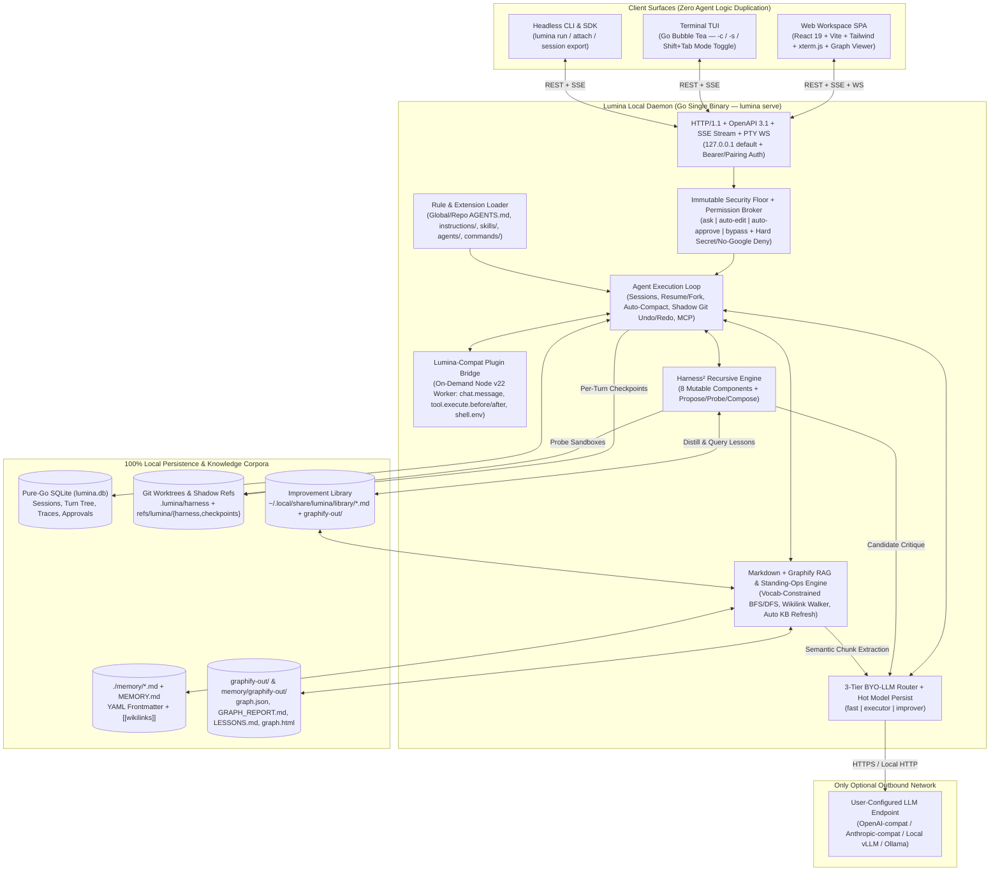

# Lumina — Architecture & Implementation Plan

> **Repository:** `8nite/lumina`  
> **Summary:** A local-first, self-improving AI coding & open-world agent harness featuring a decoupled client–server daemon (`lumina serve`), Lumina-style Web UI + Terminal TUI frontends, **`Plan` ↔ `Build` primary agent modes (`Tab`)**, **Lumina-compatible JS/TS plugins + `AGENTS.md` rule hierarchy**, granular approval modes (`Shift+Tab`: `ask` / `auto-edit` / `auto-approve` / `bypass`), seamless session continuation (`-c` / `-s` / `fork` / `run`), vendor-neutral BYO-LLM routing, **Harness²** recursive self-improvement, and **Markdown + `graphify` Knowledge-Graph RAG** — with **zero Google services**.

---

## 1. Core Goals & Hard Constraints

| Pillar | Requirement | Design Commitment |
|---|---|---|
| **Lumina-Class UX + Server Mode** | Decoupled server daemon driving Web UI, TUI, and headless CLI runs | Single Go daemon (`lumina serve`) exposing OpenAPI 3.1 REST + SSE + PTY WebSockets; consumed identically by embedded React Web UI (`lumina web`), Bubble Tea TUI (`lumina` / `lumina attach`), and scriptable `lumina run`. |
| **Plan & Build Primary Modes** | Lumina-style `Plan` vs `Build` primary agent workflow | Instant **`Tab`** toggle (`plan` ↔ `build` + custom `mode: primary` agents); **`plan` mode enforces a hard Go-level read-only workspace fence** (allows `read`/`grep`/`glob`/`kb_query`/read-only `bash` + scoped `plan.md` / `.lumina/plans/*.md` writes only, even under `--bypass`) with 1-click **"Execute in Build Mode"** handoff. |
| **Session Lifecycle & Ergonomics** | Continue sessions, resume by ID, fork trajectories, undo/redo edits, hot-persist models | `-c` / `--continue` (resumes latest workspace session), `-s <id>` / `--session`, `/fork`, `/undo` + `/redo` via shadow Git checkpoints, `/compact`, `session export [--sanitize]`, and built-in `model-persist` hot-reload. |
| **Permissions, Auto-Approve & Bypass** | Interactive approval, auto-approve, and zero-prompt bypass (`yolo`) modes | 4 live-switchable modes (`Shift+Tab`: `default`/`ask`, `auto-edit`, `auto-approve`, `bypass`) + granular command/path glob rules (`allow`/`ask`/`deny`) — while **never** bypassing credential-file blocks or the No-Google rule. |
| **Lumina-Compatible Plugins & `AGENTS.md`** | Drop-in support for Lumina plugin hooks, global/repo `AGENTS.md`, `instructions/`, `skills/`, `agents/`, `commands/` | Persistent Node v22 plugin host worker (`internal/plugins`) supporting both Lumina return-object and v2 `setup(ctx)` plugin formats + hierarchical `AGENTS.md` / `instructions/*.md` merging. |
| **Bring-Your-Own LLM (BYO-LLM)** | Use any custom LLM provider or local inference server | Native Go streaming adapters for **OpenAI-compatible**, **Anthropic-compatible**, and **Ollama** endpoints with 3-tier role routing (`fast`, `executor`, `improver`). |
| **Markdown + `graphify` RAG** | `"Text > Brain"` RAG modeled on Lumina's `./memory/` + `graphify` + `standing-ops` workflow | Plain Markdown (`YAML` frontmatter + `[[wikilinks]]`) + **`graphify`** knowledge graphs (`graph.json`, `GRAPH_REPORT.md`, `LESSONS.md`, `graph.html`) with `<2ms` Go BFS/DFS traversal and singleflight auto-refresh. Zero vector DBs. |
| **Harness² Self-Improvement** | Recursive harness optimization (`arXiv:2610.14224`) without weight tuning | **8 editable harness components** on `refs/lumina/harness`, **Level-1 `Propose → Probe → Compose`** in `git worktree` sandboxes, and **Level-2 Improvement Library** indexed by `graphify`. |
| **Zero Google Services & Secret Guard** | No Google APIs/SDKs/fonts; zero secret exposure in configs, DB, `./memory/`, or logs | Hard-blocks Google domains & `graphify` `gemini`/`--google-workspace` paths; bundled `.woff2` fonts; `api_key_env`/`api_key_cmd` indirection only; immutable credential-file hard-deny across all modes. |

---

## 2. System Architecture



---

## 3. Technology Stack (Ponytail Principles: Boring, Minimal, Zero CGO)

| Layer | Choice | Why This (Ponytail Rationale) | Skipped (Add Only When Needed) |
|---|---|---|---|
| **Daemon & CLI** | **Go 1.22+** (`cmd/lumina`, `CGO_ENABLED=0`) | Stdlib `net/http` routing + native SSE; bundles TUI + Server + Web SPA (`//go:embed`) into **one static binary**. | Separate microservices, gRPC codegen, CGO C-extensions. |
| **Plugin Runtime** | **On-Demand Node v22 Worker** (`internal/plugins/host.mjs` over Unix socket JSON-RPC) | Node v22 is already installed and runs `.js`/`.ts` natively; gives **100% compatibility with real Lumina plugins** (`rtk.ts`, `workspace-fence.js`, `pdf-vision`, etc.); zero cost when no JS/TS plugins are configured. | Custom embedded JS VMs (`goja`) that break on `node:fs`/`child_process` imports. |
| **Knowledge & RAG** | **Plain Markdown (`./memory/*.md`)** + **`graphify`** (`graphifyy` + native Go `graph.json` reader) | Human-editable `.md` source of truth, 0-token AST code graphs, community clustering, God Nodes, `LESSONS.md` feedback loop, and `graph.html`. | Vector DB daemons (Qdrant/Milvus), `sqlite-vec`, separate embedding servers. |
| **Session & Trace Store** | **Pure-Go SQLite** (`modernc.org/sqlite`, `WAL` mode) | Stores sessions, branched turn trees (for `-c`, `-s`, `/fork`), approval grants, and Harness² traces in `.lumina/lumina.db`. | Postgres, Redis. |
| **Terminal UI** | **Bubble Tea** + **Lipgloss** + **Glamour** | Instant `<30ms` startup; live `Shift+Tab` mode indicator (`ASK` / `AUTO-EDIT` / `AUTO` / `BYPASS`); speaks to `lumina serve` via `pkg/sdk`. | Custom ANSI curses engine. |
| **Web Frontend** | **TypeScript + React 19 + Vite + Tailwind CSS** (`pnpm`) | Embedded SPA (`//go:embed`); `openapi-typescript` SDK; `xterm.js` PTY; diff viewer; `graphify` canvas; session switcher & permission mode toggle. | SSR frameworks (Next.js), Google Fonts CDN, heavy state libraries. |
| **Checkpoints & Sandboxing** | **Git Plumbing (`GIT_INDEX_FILE` / `refs/lumina/*`) + `git worktree`** | Instant per-turn `/undo` & `/redo` without polluting user `git log`, plus CoW isolation for Harness² `Probe` runs (+ optional rootless Docker). | Custom FUSE/overlayfs daemons. |

---

## 4. Repository Layout (`8nite/lumina`)

```text
lumina/
├── cmd/
│   └── lumina/                 # CLI: `lumina` (TUI), `run`, `serve`, `web`, `attach`, `session`, `plugin`, `kb`, `evolve`
├── internal/
│   ├── config/                 # TOML loader, hot-reload + model-persist, env/cmd secret resolver, no-Google validator
│   ├── server/                 # net/http router, OpenAPI 3.1 spec, SSE broker, PTY WS, auth/CORS
│   ├── security/               # Immutable guardrails, 4-mode permission broker, 2-layer secret filter, session TMPDIR
│   ├── rules/                  # Hierarchical AGENTS.md + instructions/*.md + skills/ + agents/ + commands/ loader
│   ├── plugins/                # Lumina-compatible JS/TS plugin host bridge (host.mjs + JSON-RPC hook pipeline)
│   ├── llm/                    # Streaming Provider interface, openai_compat, anthropic, ollama, 3-tier router
│   ├── agent/                  # Turn loop, session resume/fork, compactor, shadow-git undo/redo, subagent runner
│   ├── tools/                  # read, edit, write, bash, grep, glob, skill, lsp, mcp, kb_query, memory_write
│   ├── kb/                     # Markdown + graphify engine: Go graph.json BFS/DFS, wikilinks, standing-ops sweeper
│   ├── harness/                # Harness² engine: 8-component loader, propose, probe, compose, library
│   └── tui/                    # Bubble Tea TUI client (talks exclusively to internal/server via pkg/sdk)
├── pkg/
│   └── sdk/                    # Typed Go client for HTTP + SSE daemon API
├── web/                        # Lumina-style Browser Workspace (React + TS + Vite + Tailwind)
│   ├── src/
│   │   ├── api/                # Generated OpenAPI TypeScript client + SSE event store
│   │   ├── components/         # ChatTimeline, DiffViewer, FileTree, TerminalPane, GraphifyPane, HarnessPane, ModeBar
│   │   └── fonts/              # Bundled local .woff2 fonts (zero external CDN requests)
│   └── embed.go                # //go:embed dist/*
├── memory/                     # Durable workspace Markdown memory + memory/graphify-out/
├── Makefile                    # build, dev, test, openapi-gen, lint
└── plan.md
```

---

## 5. Server Mode, Sessions, CLI & Lumina-Style Frontends

### 5.1 CLI & Session Commands

| Command / Flag | Behavior |
|---|---|
| `lumina` | Starts/attaches to workspace daemon and opens **Terminal TUI** in a fresh session (`build` agent default). |
| `lumina --agent plan\|build` (or `--plan`) | Launches in **`plan`** (read-only research & blueprinting) or **`build`** (full execution) primary agent mode; toggleable live via **`Tab`** or `/plan` & `/build`. |
| `lumina -c` / `lumina --continue` | Resumes the **most recent session for the current workspace directory** (`cwd`), preserving its active `plan`/`build` agent and permission mode. |
| `lumina -s <id>` / `--session <id>` | Resumes a specific session ID (works across TUI, `lumina run`, and Web URL `/s/<id>`). |
| `lumina --auto-edit \| -y (--auto-approve) \| --bypass` | Launches session in the selected permission mode (also switchable live mid-session via **`Shift+Tab`** or `/mode`). |
| `lumina run [flags] "<prompt>"` | Non-interactive headless execution (`--agent plan\|build`, `-c`, `-s <id>`, `-m provider/model`, `--auto-approve`, `--bypass`, `--format text\|json`) — parity with `lumina run`. |
| `lumina session [list\|show\|fork\|export\|delete]` | List workspace/all sessions, fork from any turn, or export transcript (`--sanitize` strips sensitive patterns). |
| `lumina serve` | Runs headless **Server Mode** (`127.0.0.1:7432` default; `--host`, `--port`, `--cors`) with hot config/model persistence and the **Standing-Ops KB Sweeper**. |
| `lumina web` | Ensures `lumina serve` is running, serves embedded Web SPA, and prints/opens `http://127.0.0.1:7432`. |
| `lumina attach <url>` | Connects local TUI to a running local or LAN/Tailscale `lumina serve` daemon. |
| `lumina plugin [list\|enable\|disable\|doctor]` | Inspect loaded global/workspace plugins, hook registrations, and latency/errors. |
| `lumina kb [query\|update\|reflect\|status]` | Direct CLI access to `./memory/` and workspace `graphify` graphs. |
| `lumina evolve [session-id]` | Triggers a Harness² `Propose → Probe → Compose` self-improvement run. |

### 5.2 Session Continuation, Forking, Checkpoints & Compaction (`internal/agent`)
- **Workspace-Attributed Persistent Sessions:** Every session stores its immutable `workspace_dir`, parent `session_id` (if forked), active `permission_mode`, `model` override, and tree of turns/parts in `.lumina/lumina.db`.
- **Continue & Multi-Client Sync:** Any session can be started in TUI (`lumina`), continued later via `lumina -c` or `lumina run -c "..."`, or opened simultaneously in `lumina web` — SSE broadcasts keep all attached clients synchronized in real time.
- **Shadow Git Checkpoints (`/undo` & `/redo`):** Before every mutating turn, Lumina snapshots the workspace tree onto an internal Git ref (`refs/lumina/checkpoints/<session-id>/<turn>`) using a dedicated `GIT_INDEX_FILE` — touching zero user commits or staging index, and enabling instant 1-click revert/redo in both Web UI and TUI.
- **Built-in `model-persist` & Live `/config` Broadcast:** Selecting a primary `executor` model from Web UI, TUI, or CLI updates the live daemon state immediately, persists across restarts, and broadcasts an SSE `config.updated` event (while ignoring `fast`-tier background/title/KB calls so they never hijack the default model).
- **Smart Auto-Compaction (`/compact`):** When context crosses ~80% of the active model's window, Tier-1/2 summarizes stale tool outputs while keeping `AGENTS.md` rules, active file diffs, and `./memory/` pointers intact.

### 5.3 Daemon API Surface (`/api/v1` + `/openapi.json`)

| Endpoint | Protocol | Purpose |
|---|---|---|
| `GET /openapi.json` | HTTP JSON | OpenAPI 3.1 schema (single source of truth for `web/` TS SDK). |
| `GET /api/v1/events` | **SSE** | Multiplexed stream: token deltas, tool progress, diffs, permission prompts, mode/model updates, KB & Harness² events. |
| `POST /api/v1/sessions` / `GET /api/v1/sessions` | HTTP JSON | Create, list (`?directory=`, `?latest=1` for `-c`), search, or delete sessions. |
| `PATCH /api/v1/sessions/{id}` | HTTP JSON | Live-update session primary `agent` (`plan`\|`build`\|`<custom>`), `permission_mode` (`ask`\|`auto-edit`\|`auto-approve`\|`bypass`), `model`, or `title`. |
| `POST /api/v1/sessions/{id}/fork` | HTTP JSON | Fork session at `turn_id` into a new branch session. |
| `GET /api/v1/sessions/{id}/export` | HTTP JSON | Full-fidelity or `--sanitize` JSON/Markdown session transcript export. |
| `POST /api/v1/sessions/{id}/prompt` | HTTP JSON | Submit turn (`@file`, `[[memory]]`, `/command`, attachments) or `/abort`. |
| `POST /api/v1/sessions/{id}/revert` & `/unrevert` | HTTP JSON | Shadow-Git `/undo` and `/redo` to any turn checkpoint. |
| `POST /api/v1/permissions/{reqId}` | HTTP JSON | Respond `allow_once`, `allow_session` (persists glob for session), `allow_always`, or `deny`. |
| `GET /api/v1/files` & `GET /api/v1/git/diff` | HTTP JSON | Workspace file tree, file preview, and live Git working-tree / per-turn diffs. |
| `GET /api/v1/pty` | **WebSocket** | Interactive local shell PTY (inherits per-session `TMPDIR` & `shell.env` plugin hooks). |
| `GET /api/v1/providers` / `PUT /api/v1/router` | HTTP JSON | Inspect BYO-LLM providers and live-switch `fast` / `executor` / `improver` models. |
| `GET /api/v1/kb/*` / `POST /api/v1/kb/query` | HTTP JSON/HTML | Query `graphify`, browse `./memory/*.md`, trigger KB refresh, or render `graph.html` / `GRAPH_REPORT.md`. |
| `GET /api/v1/harness` / `POST /api/v1/harness/evolve` | HTTP JSON | Inspect/edit the 8 harness components, view `refs/lumina/harness` diffs, or run `Propose–Probe–Compose`. |

### 5.4 Web Workspace UX (`web/`)
- **Top Mode & Session Bar:** Active workspace badge, session picker (`Continue Last`, `New`, `Fork`, `Export`), model/tier selector, **Primary Agent Toggle (`PLAN` ↔ `BUILD` + custom primary agents, hotkey `Tab`)**, and orthogonal **Permission Mode Pill** (`ASK` · `AUTO-EDIT` · `AUTO-APPROVE` · `BYPASS`, hotkey `Shift+Tab`).
- **Left Sidebar:** Session history list, Git-badged File Tree, **Memory & Graph Tab** (`./memory/*.md` + `[[wikilinks]]` + Communities / God Nodes), and **Harness² & Plugins Tab**.
- **Center Stage:** Streaming timeline with `> plan · <model>` / `> build · <model>` turn headers, rendered **Plan Artifact Card** with interactive task checkboxes and a 1-click **"Build This Plan"** action button, compact tool-call pills, inline permission cards, per-turn `Undo`, and composer supporting `@file`, `[[memory-note]]`, attachments, and `/commands` (`/plan`, `/build`, `/resume`, `/fork`, `/mode`, `/compact`, `/undo`, `/redo`, `/graphify`, `/evolve`, `/init`).
- **Right Split / Bottom Drawer:** Split & unified Diff Viewer (1-click hunk revert), live `plan.md` / `.lumina/plans/*.md` preview & editor, `xterm.js` PTY terminal, **Interactive Graphify Canvas** (`graph.html` / `GRAPH_REPORT.md`), and **Harness² Probe Comparator**.

---

## 6. Global Rules (`AGENTS.md`), Extensions & Lumina-Compatible Plugins

### 6.1 Rule & Markdown Extension Discovery (`internal/rules`)

Lumina natively honors the same Markdown customization conventions used across Lumina and Claude setups, hot-reloaded on file `mtime` change:

1. **System Instruction Merge Order (top-to-bottom):**
   - **Layer 0 — Immutable Security Core:** Compiled Go directives (workspace fence, secret non-exposure, no-Google policy).
   - **Layer 1 — Global Rules:** `~/.config/lumina/AGENTS.md` + `~/.config/lumina/instructions/*.md` (plus optional read-only import of `~/.config/lumina/AGENTS.md`, `~/.config/lumina/instructions/*.md`, and `~/.claude/CLAUDE.md` via `compat.import_global_rules = true`).
   - **Layer 2 — Project & Directory Rules:** `AGENTS.md` (falling back to `CLAUDE.md` if `AGENTS.md` is absent) walked from workspace Git root down to target directory + `.lumina/instructions/*.md`.
   - **Layer 3 — Mutable Harness² Overlay:** `.lumina/harness/system_prompt.md` + `tool_guidance.md`.
2. **Skills (`skills/<name>/SKILL.md`):** Discovered from `~/.config/lumina/skills/`, `.lumina/skills/`, `.lumina/harness/skills/` (and optionally `~/.config/lumina/skills/` & `~/.claude/skills/`). Only `name` + `description` frontmatter ship in the tool list; full `SKILL.md` loads lazily via the `skill` tool.
3. **Custom Subagents (`agents/<name>.md`):** Markdown + YAML frontmatter (`name`, `description`, `mode: subagent|primary`, `hidden`, `model`, `tools: { bash: false, ... }`) — compatible with `~/.config/lumina/agents/*.md`.
4. **Custom Slash Commands (`commands/<name>.md`):** Prompt templates expanding `$ARGUMENTS`, `@file`, and `!cmd` context — compatible with `~/.config/lumina/commands/*.md` (e.g., `/ponytail`, `/autoresearch_*`).

### 6.2 Lumina-Compatible Plugin System (`internal/plugins`)

Modeled directly on the host's live `~/.config/lumina/plugins/` (`rtk.ts`, `workspace-fence.js`, `secure-credentials-guard.js`, `standing-ops.js`, `model-persist`, `pdf-vision`):

- **Discovery Roots:**
  - Global: `~/.config/lumina/plugins/*.{js,mjs,ts}` and `~/.config/lumina/plugins/<name>/plugin.{js,mjs,ts}` (plus optional opt-in loading from `~/.config/lumina/plugins/`).
  - Workspace: `.lumina/plugins/` and Harness² `.lumina/harness/plugins/` (user-approved).
- **Both Lumina Plugin Signatures Supported:**
  1. **Factory / Return-Object Style:** `export default async ({ $, serverUrl, directory, session }) => ({ ...hooks })` (used by `rtk.ts`, `model-persist`, `pdf-vision`).
  2. **v2 Object `setup(ctx)` Style:** `export default { id, async setup(ctx) { await ctx.tool.hook("execute.before", fn) } }` (used by `standing-ops.js`, `secure-credentials-guard.js`, `workspace-fence.js`).
- **Supported Lifecycle Hooks:**

| Hook Name | Capabilities | Example Use Case |
|---|---|---|
| `config` | Inspect effective config on load/reload | Capture boot defaults, validate env prerequisites (`which rtk`) |
| `chat.message` | Mutate incoming `output.parts` or `output.message.model` before turn dispatch | Attachment text extraction (`pdf-vision`), model routing overrides |
| `chat.messages.transform` | Transform message array right before provider HTTP call | Context pruning, attachment fallback |
| `tool.execute.before` | Inspect/mutate `output.args` (e.g. rewrite `bash` command) or `throw Error(...)` to block and return guidance to the LLM | `rtk rewrite` token-saving CLI wrapper; domain-specific guardrails |
| `tool.execute.after` | Observe tool args, result, duration, and `sessionID` asynchronously | Deployment regression triggers (`standing-ops` e2e gate), audit logging |
| `shell.env` | Inject/override environment variables (`output.env`) per `bash`/PTY call | Per-session `TMPDIR` or tool PATH injection |
| `permission.ask` | Return `"allow"` / `"deny"` / `"ask"` before prompting user | Custom organizational auto-approval policies |
| `event` | Subscribe to daemon lifecycle events (`session.created`, `session.idle`, `session.deleted`) | Scratch cleanup on `session.deleted` |

- **Execution Isolation:** Runs in a single persistent local Node v22 child process (`host.mjs`) over a local Unix domain socket with per-hook timeouts (`5s` default, configurable for heavy attachment hooks) so a buggy plugin never crashes `lumina serve`.

---

## 7. Primary Agent Modes (`Plan` ↔ `Build`) & Permission Broker (`internal/security`)

Lumina separates **what the agent is allowed to do structurally** (**Primary Agent Mode**, toggled via **`Tab`**) from **how tool approvals are prompted** (**Permission Mode**, toggled via **`Shift+Tab`**), matching Lumina's dual-axis workflow:

### 7.1 Primary Agent Modes (`Plan` vs `Build` + Custom Primary Agents)

| Primary Agent | Hotkey / Trigger | Structural Tool Envelope (Enforced in Go Core) | Default Router Role |
|---|---|---|---|
| **`plan`** | `Tab` / `/plan` / `--plan` | **Read-Only Codebase Fence:** Allows `read_file`, `glob`, `grep`, `lsp`, `kb_query` (`graphify`), `question`, read-only `bash` inspection (`git status/diff/log`, `ls`, etc.), and **scoped writes ONLY to `plan.md` or `.lumina/plans/<session>.md`**. Blocks source-tree `edit`/`write` and mutating shell commands **even when Permission Mode is `auto-approve` or `bypass`**. | `planner` *(falls back to `improver` or `executor`)* |
| **`build`** *(default)* | `Tab` / `/build` / `--agent build` | **Full Execution Envelope:** Enables `edit_file`, `write_file`, `patch`, general `bash`, `memory_write`, `mcp`, `todowrite`, and subagents, governed by the active Permission Mode (`ask` / `auto-edit` / `auto-approve` / `bypass`). | `executor` |
| **Custom (`agents/*.md`)** | `Tab` cycle / `--agent <name>` | User-defined primary agents (`mode: primary`) with custom frontmatter tool matrices (e.g. `review`, `security-audit`). | Per-agent `model` or `executor` |

- **Seamless `Plan → Build` Handoff:** Approving a plan in `plan` mode (clicking **"Build This Plan"** in `lumina web` or pressing `Tab` in TUI) switches the session in-place to `build`, compacts exploratory `plan`-turn read blobs into a clean reference to `.lumina/plans/<session>.md` (§2 Reference Over Inline), and tracks checklist progress live.

### 7.2 Four Live-Switchable Permission Modes (`Shift+Tab`)

Switchable at launch (`--auto-edit`, `-y`/`--auto-approve`, `--bypass`), mid-session via `Shift+Tab` (TUI) / Mode Pill (Web UI) / `/mode <name>`, or per-session API (evaluated *inside* the active `plan`/`build` agent's structural envelope):

| Action Category | `default` (`ask`) | `auto-edit` | `auto-approve` (`-y`) | `bypass` (`--bypass`) |
|---|---|---|---|---|
| **Workspace Reads (`read`, `glob`, `grep`, `kb_query`)** | `allow` | `allow` | `allow` | `allow` |
| **Shared Read-Only Tooling Docs (`skills/`, `AGENTS.md`)** | `allow` (read-only) | `allow` (read-only) | `allow` (read-only) | `allow` (read-only; writes blocked unless `--allow-tooling-write`) |
| **Workspace File Edits (`edit`, `write`, `/tmp/lumina-ses-*`)** | `ask` *(or `allow` per config)* | **`allow`** | **`allow`** | **`allow`** |
| **Safe Read-Only Shell (`git status/diff/log`, `ls`, `go test`)** | `allow` *(configurable)* | `allow` | **`allow`** | **`allow`** |
| **General Workspace Shell (`bash`)** | `ask` | `ask` | **`allow`** *(destructive patterns still `ask`)* | **`allow` (zero prompts)** |
| **Destructive Shell (`rm -rf`, `git push --force`, `git reset --hard`)** | `ask` | `ask` | `ask` | **`allow`** |
| **Cross-Workspace (`external_directory`) & Harness² `scripts/`** | `ask` | `ask` | `ask` | **`allow`** |
| **Credential / Secret Files & `--from-literal=` & Google Domains** | **HARD DENY** | **HARD DENY** | **HARD DENY** | **HARD DENY (never bypassable)** |

### 7.3 Granular Rule Overrides & Session Hygiene
- **Pattern Overrides in `config.toml`:** Fine-grained glob/command rules matching Lumina's permission matrix (e.g., `[permissions.bash] "go test *" = "allow"`, `"kubectl delete *" = "ask"`, `"*" = "ask"`).
- **Session-Scoped Approvals (`allow_session`):** Approving a tool prompt with *"Allow for Session"* caches the scoped path/command prefix in memory for that `session_id` without mutating global config.
- **Native Workspace Fence & `/tmp` Hygiene:** Every session automatically gets `TMPDIR=/tmp/lumina-ses-<id>` injected into `bash` and PTY shells, recursively cleaned on `session.deleted` or daemon startup sweep.

---

## 8. Bring-Your-Own LLM Provider & Three-Tier Router (`internal/llm`)

### 8.1 Vendor-Neutral Protocol Adapters
Pure Go streaming HTTP/SSE clients with zero vendor SDK lock-in:
1. **`openai-compatible`**: OpenAI, OpenRouter, DeepSeek, Groq, Together, Fireworks, LiteLLM, vLLM, SGLang, `llama-server`, LM Studio (`/v1/chat/completions` & `/v1/responses`, tool calling, `reasoning_content`).
2. **`anthropic-compatible`**: Native `/v1/messages` SSE streaming, tool use, thinking blocks, and prompt-cache breakpoints.
3. **`ollama`**: Direct `http://127.0.0.1:11434` `/api/chat` integration.
4. **`copilot`**: GitHub Copilot (SaaS, Enterprise, GHES) via token exchange (`copilot_internal/v2/token`) + OpenAI-compatible chat. Per-user `base_url` / `token_url` overrides; GitHub token via `api_key_env` / `api_key_cmd` (`gh auth token`) or device web-auth token store; `/model` picker + `/api/v1/models` live listing.

### 8.2 Configuration & Secret Indirection (`~/.config/lumina/config.toml`)

```toml
[server]
host = "127.0.0.1"
port = 7432

[defaults]
agent           = "build"             # "build" | "plan" | custom primary agent name
permission_mode = "ask"               # "ask" | "auto-edit" | "auto-approve" | "bypass"

[compat]
import_global_rules   = true          # Also load ~/.config/lumina/AGENTS.md & instructions/*.md (read-only)
import_global_skills  = true          # Discover ~/.config/lumina/skills & ~/.claude/skills

[permissions]
edit = "allow"
external_directory = "ask"

[permissions.bash]
"git status*" = "allow"
"git diff*"   = "allow"
"go test*"    = "allow"
"pnpm test*"  = "allow"
"*"           = "ask"

[providers.custom_vllm]
protocol = "openai-compatible"
base_url = "http://127.0.0.1:8000/v1"
api_key_env = "VLLM_API_KEY"          # Plaintext `api_key = "..."` is rejected at load time

[providers.openrouter]
protocol = "openai-compatible"
base_url = "https://openrouter.ai/api/v1"
api_key_cmd = "your-secret-helper --get my-key"   # any command printing the key to stdout

[providers.anthropic]
protocol = "anthropic-compatible"
base_url = "https://api.anthropic.com"
api_key_env = "ANTHROPIC_API_KEY"

[providers.local_ollama]
protocol = "ollama"
base_url = "http://127.0.0.1:11434"

[router]
fast     = "local_ollama/qwen2.5-coder:7b"       # Tier 1: vocab expansion, KB distillation, graphify doc chunks
executor = "anthropic/claude-sonnet-4-20250514"  # Tier 2: primary `build` coding & tool execution (hot-persisted)
planner  = "openrouter/deepseek/deepseek-r1"     # Optional `plan` mode model (defaults to executor if omitted)
improver = "openrouter/deepseek/deepseek-r1"     # Tier 3: Harness² Propose & Compose reasoning

[kb]
idle_debounce_minutes = 10                       # Standing-ops auto-distill + graphify refresh threshold
auto_commit_ast_hook  = true                     # Rebuild workspace AST graph on git commit (0 LLM tokens)
```

---

## 9. Markdown + `graphify` RAG & Standing-Ops Engine (`internal/kb`)

Directly implements the host Lumina's **4-Phase Memory Protocol + `graphify` + `standing-ops`** architecture — while eliminating the concurrency, manifest-path, and headless-extraction sharp edges seen in `/tmp/standing-ops*` logs.

### 9.1 Three Markdown + `graphify` Corpora (Zero Vector Blobs)

| Corpus | Source of Truth | Graphify Outputs | Extraction Mode |
|---|---|---|---|
| **1. Workspace Memory** | `./memory/MEMORY.md` (`INDEX.md`) + atomic `./memory/*.md` (YAML frontmatter + `[[wikilinks]]`) | `./memory/graphify-out/` (`graph.json`, `GRAPH_REPORT.md`, `graph.html`, `manifest.json`, `reflections/LESSONS.md`, `.last-graphify`) | Incremental semantic extraction via Lumina Tier-1/2 router |
| **2. Workspace Code & Docs** | Repo source code + architecture `.md` docs | `./graphify-out/` (`graph.json`, `GRAPH_REPORT.md`, `graph.html`, `manifest.json`) | **Code:** 100% deterministic local AST (`0` LLM tokens) on file watch / `git commit`. **Docs:** Incremental Tier-1/2 semantic extraction |
| **3. Harness² Library** | `~/.local/share/lumina/library/*.md` + `.lumina/library/*.md` (lessons, skills, patches) | `library/graphify-out/` + optional merge into `~/.graphify/global-graph.json` | Incremental semantic extraction on lesson promotion |

### 9.2 Four-Phase Retrieval, Synthesis & Graph Lifecycle


1. **Phase 1 — Read-on-Start & Graph-First Retrieval (`kb_query`):**
   - **Cold-Start Read:** Runs `graphify reflect --if-stale` (deterministic, zero LLM tokens) and loads `memory/graphify-out/reflections/LESSONS.md` (*preferred sources*, *known dead ends*, *prior corrections*) + `./memory/MEMORY.md`.
   - **Constrained Vocabulary Expansion (`Step 0`):** Extracts token vocabulary from `graph.json` node labels; Tier-1 (`fast`) maps query intent onto $\le 12$ tokens strictly present in that vocabulary (zero invented synonyms).
   - **In-Process Go Graph Traversal (`<2ms`):** Reads `memory/graphify-out/graph.json` and `./graphify-out/graph.json` in Go memory (`bfs`, `dfs`, `shortest_path`, `explain`, `affected`, `community`, `god_nodes`) within `--budget` tokens, citing `source_file`, `source_location`, and edge confidence (`EXTRACTED` / `INFERRED` / `AMBIGUOUS`).
   - **Recursive `[[wikilink]]` Resolution:** Follows `[[wikilinks]]` across `./memory/*.md` (cycle-safe, budget-capped) before falling back to codebase `grep`/`glob`.
2. **Phase 2 — Graph-Aware Markdown Synthesis & Dedup-on-Write (`memory_write`):**
   - Writes atomic `./memory/<topic>.md` notes with YAML frontmatter (`date_modified`, `tags`, `author`) and `[[wikilinks]]`, updating `./memory/MEMORY.md` in place without duplicate entries, guarded by a 2-layer secret scanner.
3. **Phase 3 — 100% Google-Free `graphify` Extraction & Native Fixes:**
   - Strips `GEMINI_API_KEY` / `GOOGLE_API_KEY` and routes `.md` semantic extraction through Lumina's loopback BYO-LLM proxy (`fast`/`executor`).
   - Fixes the three Lumina log sharp edges natively in Go: (a) **singleflight per-workspace sweeper mutex** (no `6×` hook race), (b) **canonical `root`-relative `manifest.json` stamping** honoring `#2015`, and (c) **strict schema normalization** (`hyperedges[].nodes`, discrete confidence rubric, `#479` shrink-guard).
4. **Phase 4 — Built-in `standing-ops` Auto-Save & Outcome Feedback:**
   - Logs query outcomes via `save-result --outcome useful|dead_end|corrected`, and runs idle (`>10m`) / session-close transcript distillation + incremental `graphify` refresh with `[standing-ops]` loop protection.

---

## 10. Harness² Recursive Self-Improvement Architecture (`internal/harness`)

Adapted from **Harness² (*Recursive Agent Harnessing for an Open World*, arXiv:2610.14224)** and unified with Lumina's plugin host and `graphify` knowledge layer.

### 10.1 The 8 Editable Harness Components (`.lumina/harness/`)

Versioned on local Git ref `refs/lumina/harness` so workspace `git status` stays clean and every self-edit is diffable and 1-click revertible:

| # | Component | Path in `.lumina/harness/` | Role | Self-Edit Policy |
|---|---|---|---|---|
| 1 | **System Prompt** | `system_prompt.md` | Task framing, token compression (§1–§15 doctrine), reasoning split | Auto-proposable; Quality-Floor gated |
| 2 | **Guardrails** | `guardrails.yaml` | Task-level pre/post checks, retry caps, lint/test gates (additive only — cannot weaken `internal/security`) | Additive auto; loosening blocked by Go core |
| 3 | **Memory** | `memory/` (`-> ./memory/`) | Active self-editing `./memory/*.md` + `memory/graphify-out/` graph | Auto-updated via Phase 2–4 protocol |
| 4 | **Tool Guidance** | `tool_guidance.md` | Heuristics for `kb_query` vs `grep` vs `edit_file`, batching, error recovery | Auto-proposable; Quality-Floor gated |
| 5 | **Subagents** | `subagents/<name>/AGENT.md` | Scoped helper roles (`researcher`, `reviewer`, `kb-distiller`), tools & tier | Auto-proposable |
| 6 | **Skills** | `skills/<name>/SKILL.md` | Reusable step-by-step SOPs with YAML frontmatter & `[[wikilinks]]` | Auto-proposable & promotable to Library |
| 7 | **Scripts** | `scripts/<name>.sh\|.py` | Deterministic local helper scripts synthesized when code beats LLM calls | **Gated (`ask` unless `--bypass`)** + sandbox |
| 8 | **Plugins** | `plugins/<name>/plugin.js` | Lumina-compatible hook middleware (`tool.execute.before/after`, `chat.message`) | **Gated (`ask` unless `--bypass`)** + sandbox |

### 10.2 Dual-Level Recursion
- **Level 1 (`Propose → Probe → Compose`):** On friction detection or `/evolve`, `improver` queries the `graphify` Library, proposes $k$ candidate patches against `.lumina/harness/`, replays matched probes in isolated `git worktree` sandboxes (`/tmp/lumina-probe-*`, plus isolated scratch-port e2e gates when `scripts/e2e-*.sh` exists), evaluates deterministic verifiers + open-world behavioral contrasts, and commits non-degrading winners ($\Delta^* \ge H_0$) to `refs/lumina/harness`.
- **Level 2 (`graphify`-Indexed Improvement Library):** Validated improvements distill into `~/.local/share/lumina/library/` Markdown notes + `SKILL.md` playbooks with `rationale` attributes and hyperedges, indexed into `library/graphify-out/graph.json` for selective task-start mounting without prompt bloat.

---

## 11. Phased Implementation Plan & Runnable Verification Gates

### Milestone 0 — Repo Skeleton, Config, Rules (`AGENTS.md`) & Security Core
- Initialize Go module (`github.com/8nite/lumina`), `pnpm` workspace (`web/`), `Makefile`, and pure-Go SQLite (`modernc.org/sqlite`) schema.
- Implement `internal/config` (TOML + hot-reload + `api_key_env`/`api_key_cmd` + Google-domain blocklist), `internal/rules` (`AGENTS.md` + `instructions/*.md` + `skills/` + `agents/` + `commands/` discovery), and `internal/security` (`plan` vs `build` structural fence + 4-mode permission broker: `ask` / `auto-edit` / `auto-approve` / `bypass`, immutable credential-file hard-deny even in `bypass`, per-session `TMPDIR` lifecycle).
- **Verification Gate:** `CGO_ENABLED=0 go test ./internal/config ./internal/rules ./internal/security ./internal/server` — verifies `AGENTS.md` precedence, confirms `plan` mode blocks code mutations even when `--bypass` is set (allowing only `plan.md` / `.lumina/plans/*.md`), confirms `--bypass` in `build` mode still hard-denies `.env`/`auth.json`/`lumina.json`/`*.googleapis.com`, and validates `/openapi.json`.

### Milestone 1 — BYO-LLM Router, Sessions (`-c`/`-s`/`fork`/`run`), Undo & Plugin Host
- Build streaming `openai-compatible`, `anthropic-compatible`, and `ollama` providers + 3-tier router + built-in `model-persist`.
- Implement persistent sessions (`-c` continue latest per-workspace, `-s <id>`, `/fork`, `session export --sanitize`), `lumina run` headless CLI, shadow-Git `/undo` & `/redo`, auto-compaction, and core tools (`read`, `edit`, `write`, `bash`, `grep`, `glob`, `skill`).
- Implement `internal/plugins` (`host.mjs` Node v22 bridge supporting Lumina return-object & v2 `setup(ctx)` plugins: `chat.message`, `tool.execute.before/after`, `shell.env`, `permission.ask`, `event`).
- **Verification Gate:** Integration tests verifying: (a) `lumina run` → `lumina run -c` continues exact workspace session context, (b) `/fork` and shadow-Git `/undo`+`/redo` restore exact file trees, and (c) sample Lumina plugins (`rtk`-style arg rewriter + `secure-credentials-guard`-style blocker) execute accurately through the Go↔Node hook pipeline.

### Milestone 2 — Markdown + `graphify` RAG & Standing-Ops Engine (`internal/kb`)
- Implement `<2ms` Go `graph.json` traverser (`bfs`, `dfs`, `shortest_path`, `explain`, `affected`, `god_nodes`, constrained `.vocab.txt` expansion) + recursive `[[wikilink]]` reader + `memory_write` dedup & secret filter.
- Build Google-free `graphify` bridge (AST code extraction + Tier-1/2 semantic `.md` chunk extraction + schema/hyperedge normalizer + canonical `manifest.json` stamper + `#479` shrink-guard + `save-result` / `reflect --if-stale`) and singleflight **Standing-Ops KB Sweeper** + auto-deploy isolated-port regression gate.
- **Verification Gate:** End-to-end test over `./memory/` and codebase confirming constrained-vocab traversal, `0` stale `manifest.json` entries, singleflight sweeper deduplication, and zero Google env/network usage.

### Milestone 3 — Terminal TUI (`lumina`, `-c`, `Tab` Plan/Build & `Shift+Tab` Mode Toggle)
- Build `pkg/sdk` Go HTTP + SSE client and Bubble Tea TUI (`internal/tui`) with streaming Markdown/diffs, **`Tab` primary agent toggle (`PLAN` ↔ `BUILD`)**, **`Shift+Tab` approval cycling (`ASK` / `AUTO-EDIT` / `AUTO-APPROVE` / `BYPASS`)**, `/resume` session picker, `@file` & `[[memory]]` autocomplete, inline permission modal (`Allow Once` / `Allow Session` / `Deny`), and `lumina attach`.
- **Verification Gate:** Headless Bubble Tea state-machine tests covering `-c` resume, `Tab` `plan`↔`build` handoff, `Shift+Tab` approval transitions, permission modal grants, and remote token `attach`.

### Milestone 4 — Lumina-Style Web Workspace (`lumina web`)
- Generate TypeScript SDK from `/openapi.json`; build React 19 + Vite + Tailwind SPA with bundled `.woff2` fonts, Mode/Session/Model header bar, Git-badged File Tree, Streaming Chat Timeline, Split/Unified Diff Viewer with hunk revert, `xterm.js` PTY, and embedded **`graphify` Canvas**; embed via `//go:embed`.
- **Verification Gate:** `pnpm --dir web test && pnpm --dir web build` + headless check confirming live multi-client sync (TUI + Web attached to same session), mode switching, diff undo, and strict `default-src 'self'` CSP.

### Milestone 5 — Harness² Level 1 (`Propose → Probe → Compose`)
- Implement `.lumina/harness/` 8-component loader + `refs/lumina/harness` versioning, friction detector, `Propose` generator, parallel `git worktree` `Probe` runner, contrastive scorer, `Compose` merger, and Web/TUI diff approval UI.
- **Verification Gate:** Automated `evolve` test verifying parallel candidate probes in `/tmp/lumina-probe-*` worktrees, Quality-Floor gating, `refs/lumina/harness` commit, and worktree cleanup.

### Milestone 6 — Harness² Level 2 (`graphify` Library), MCP & Single-Binary Release
- Implement `~/.local/share/lumina/library/` promotion, `library/graphify-out/` indexing, dynamic task-start `graphify` skill mounting, local MCP client (`stdio`/`SSE`), LAN/Tailscale `lumina pair`, and `CGO_ENABLED=0` release packaging.
- **Verification Gate:** Cross-session test proving a promoted `SKILL.md` is retrieved via `library/graphify-out/graph.json` in a new session and reduces tool turns without bloating `system_prompt.md`.
